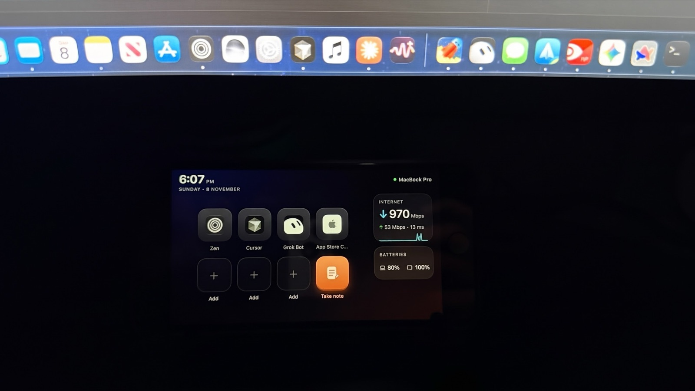
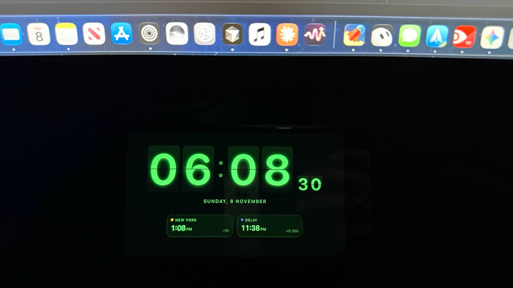

# Revive

**Give your old iPhone a second life. Turn it into a Stream Deck–style control panel and desk clock for your Mac.**
No jailbreak, no App Store, nothing to install on the phone: it runs in Safari, even on an iPhone 4S stuck on iOS 9.

| The deck | The idle flip clock (Terminal theme) |
|---|---|
|  |  |

## Features

- **8 big keys:** 7 of your choice plus **Take note**. A key can open a **Mac app**, a **website** (App Store Connect, Gmail, a dashboard…) in your default browser, or a **folder** in Finder. Website keys show the site's own icon. Hold any key to edit.
- **Flip clock when idle:** after a few minutes without a touch, the deck turns into a full-screen split-flap clock with animated digits, the date and up to **3 world clocks**. It has **6 themes** (Graphite, Paper, Amber, Terminal, Ocean, Sunset) and a **12- or 24-hour** setting. Tap to go back; hold for settings. You can also tap the time in the top-left corner.
- **Take note → new Claude chat:** dictate a note, and it opens and sends a fresh conversation in the [Claude](https://claude.ai/download) desktop app.
- **Now playing:** artwork, track, progress and previous / play-pause / next for **Spotify** or **Apple Music**. The card only appears while music is playing (and for a minute after you pause), and the keys move into its space otherwise.
- **AI agents:** an **Agents** tab shows what **Claude Code**, **Cursor** and **Grok Bot** are doing right now: each session, its project, and whether it's working, needs you, done or idle. It also shows **plan limits** with reset times: Grok Bot's weekly usage, and Claude Code's 5-hour and weekly limits (optional, see below). When no music plays, a strip on the deck shows the same at a glance, and the Agents tab gets an orange dot when an agent needs you.
- **Internet widget:** download, upload and ping (macOS's built-in `networkQuality`), plus a live traffic graph. Tap it to re-test.
- **Batteries widget:** MacBook, Magic Keyboard / Mouse / Trackpad and AirPods (with case), each as an icon + percentage.
- **Menu-bar app:** runs in the background, opens at login, and shows **QR codes** to pair a phone.
- **A link that keeps working:** the phone uses your Mac's Bonjour name (`your-mac.local`), so a Home Screen bookmark survives your router handing out a new IP address.
- **Fits any iPhone:** a compact 480×320 layout on old phones; full-width landscape and a portrait layout on modern ones.
- **Modern iPhones also get:** voice input for Take note, and a **Phone** tab that streams the camera (into OBS) and the mic (into BlackHole) to your Mac.

## Requirements

- A Mac with macOS 14 or later and the Xcode Command Line Tools (`xcode-select --install`)
- An iPhone or iPad with Safari: anything from iOS 8/9 (iPhone 4S, 5, iPad 2…) to the latest
- Both on the same Wi-Fi network

## Install (recommended)

```bash
git clone https://github.com/mayankgulaty/Revive.git
cd Revive
scripts/install.sh
```

This builds **Revive.app** into `~/Applications` and starts it. Then:

- Look for its icon (a 2×2 grid) in the **menu bar**. There's no Dock icon.
- The first launch opens **Pair a Phone**, with QR codes and the link to type on an old iPhone. You can reopen it from the menu any time.
- It turns on **Open at Login**, so the deck comes back after a restart. You can turn that off in the menu.

To update, `git pull` and run `scripts/install.sh` again. To remove it, run `scripts/install.sh --uninstall`. Your settings stay in `~/.revive`.

The script signs the app with your Apple Development or Developer ID certificate if you have one (or `SIGN_IDENTITY="…"`). That keeps macOS permissions across updates. Without one it signs ad hoc, and macOS may ask for permissions again after each update.

## Or run it from the terminal

```bash
swift build -c release
.build/release/revive
```

It prints a QR code and links, and shows the same menu-bar icon. Ctrl-C quits.

## Set up the phone

1. Open the link in **Safari**: scan the QR code (iOS 11+), or type the address shown under it, like `http://your-mac.local:8045/#k=<token>`.
2. Tap **Share → Add to Home Screen** and launch it from there to run it full screen.
3. **Hold any key** to choose your keys. *Add a website…* takes an address such as `appstoreconnect.apple.com`. *Add a folder by path…* takes a path such as `~/Documents/GitHub`.
4. **Hold the clock** for its settings:
   - **Show the clock when idle:** off, or after 1, 3, 10 or 30 minutes.
   - **Time format:** automatic (follows the phone), 12-hour or 24-hour.
   - **Theme.**
   - **Phone tab** (modern iPhones): show or hide the camera + mic tab.
   - **World clocks:** search by city or country, so "India" finds New Delhi, Mumbai, Bengaluru…

   The idle delay, time format and theme are saved on each phone. The world clocks are saved on the Mac.

If `your-mac.local` doesn't load (some mesh or office networks block Bonjour), use the IP-address link shown underneath it instead.

Tips for a dedicated desk display: set **Auto-Lock → Never**, and use **Guided Access** (Settings → Accessibility) to lock the phone to the deck. Options you can add to the link for a Home Screen bookmark:

| Add | Effect | Example |
|---|---|---|
| `?clock` | Opens straight into the clock | `http://your-mac.local:8045/?clock#k=<token>` |
| `?settings` | Opens the clock settings | |
| `?edit` | Opens the key editor | |
| `theme=<name>` | Sets the clock theme: `graphite`, `paper`, `amber`, `mint` (Terminal), `ocean` or `sunset` | `?clock&theme=amber` |

### macOS permissions (asked on first use)

| Permission | Why |
|---|---|
| **Accessibility** | Take note presses Return in Claude to send your note |
| **Automation → Spotify / Music** | Reading what's playing and controlling playback |

They're granted to **Revive** when installed, or to your terminal app when you run it from a terminal.

### Modern iPhone: voice, camera and mic (optional)

Safari only allows the microphone, camera and speech recognition on **HTTPS** pages, so Revive creates a private certificate authority on your Mac (stored in `~/.revive/tls`). Menu bar → **Pair a Phone…** has QR codes for each step:

1. On the iPhone, open `http://your-mac.local:8045/revive.mobileconfig` and tap **Allow**.
2. **Settings → Profile Downloaded → Install.**
3. **Settings → General → About → Certificate Trust Settings** → turn on **Revive CA**. *(Easy to miss: without it Safari keeps saying "This Connection Is Not Private".)*
4. Open `https://your-mac.local:8047/#k=<token>` and add it to the Home Screen.

**Camera → video calls:** in [OBS](https://obsproject.com), add a *Media Source* with `http://localhost:8045/camera.mjpg?k=<token>` (menu bar → **Copy OBS Camera URL**), then click **Start Virtual Camera**.
**Mic → video calls:** install [BlackHole 2ch](https://existential.audio/blackhole/) and restart Revive; pick "BlackHole 2ch" as the microphone in your call app.
*(For plain FaceTime or Zoom calls, macOS's built-in Continuity Camera is simpler.)*

## How it works

```
iPhone (Safari)                     Mac: Revive (Swift, no dependencies, menu-bar app)
┌──────────────────────┐  Wi-Fi    ┌───────────────────────────────────────────────────┐
│ deck page            │ ────────▶ │ :8045 HTTP   page, keys, stats, music, clocks     │
│ (ES5 JavaScript so   │           │ :8047 HTTPS  same, for modern iPhones             │
│  iOS 8/9 can run it) │ ────────▶ │ :8048 WSS    camera frames + mic audio            │
└──────────────────────┘           └───────────────────────────────────────────────────┘
```

| Feature | Mac side |
|---|---|
| App keys | `NSWorkspace` lists `/Applications`, renders icons, opens apps |
| Website keys | Opens `http(s)` links only. Icons: the site's `apple-touch-icon` or favicon, fetched once and cached in `~/.revive/icons`, or a coloured letter tile |
| Folder keys | Opens existing folders in Finder (never apps or other packages) |
| Flip clock | The phone draws it with CSS 3D flips. The Mac sends its own time and each world clock's UTC offset, because an old phone's clock drifts and iOS 9 has no time-zone support (`Intl`). Cities come from the tz database's `zone.tab` (with countries), plus well-known cities that aren't time-zone names, such as New Delhi → Asia/Kolkata |
| Take note | Opens `claude://claude.ai/new?q=…` (the same link the Claude app's own macOS Service uses), waits for Claude to come to the front, then presses Return |
| Now playing | AppleScript to Spotify / Music, with a timeout so a pending permission prompt can't freeze it |
| Internet | `/usr/bin/networkQuality -c` + `en*` interface byte counters |
| Batteries | IOKit power sources, `ioreg -r -k BatteryPercent`, `system_profiler SPBluetoothDataType` |
| HTTPS | Local CA and a server certificate for `your-mac.local` and the current IP, generated with the built-in `openssl` and served as an iOS profile |
| AI agents | Read-only, every 3 s. Claude Code: `~/.claude/sessions/<pid>.json` (status per running session). Cursor: its chat database, opened read-only. Grok Bot: its saved app state (agents, cloud agents, weekly usage). Claude Code's plan limits (optional): Anthropic's usage endpoint with your Keychain login. Cursor's plan usage is only on cursor.com, so it isn't shown |
| Menu bar | `NSStatusItem`, QR codes from Core Image, Open at Login via `SMAppService` |

The whole phone UI is one file, [`Sources/revive/web/index.html`](Sources/revive/web/index.html). It's deliberately written in ES5 (no arrow functions, `let`, `fetch`…) so iOS 8/9 Safari can run it. CI checks this on every push.

## Options

```
revive --port 8045           # HTTP port (HTTPS = port+2, WebSocket = port+3)
revive --mic-device NAME     # audio output that receives the phone's mic (default: BlackHole)
```

Settings live in `~/.revive/` (menu bar → **Show Settings Folder**):

| File | What |
|---|---|
| `token` | The access code in the link |
| `launcher.json` | Your keys |
| `clocks.json` | Your world clocks |
| `icons/` | Cached website icons. Delete one to fetch it again |
| `claude-usage-on` | Present while Claude Code plan limits are turned on (no login is stored) |
| `tls/` | Certificates for HTTPS |

### Claude Code plan limits (optional)

Claude Code doesn't save its 5-hour and weekly limits on disk. Its own `/usage` screen asks Anthropic for them, signed in with your Claude login. Menu bar → **Show Claude Code Limits on Phone** makes Revive do the same every 5 minutes:

- The login is read from **your own Mac's Keychain** while Revive runs. The first time, macOS asks whether Revive may use "Claude Code-credentials"; choose **Always Allow**.
- It's kept in memory only and sent only to `api.anthropic.com`, never to your phone, to disk or to this repository. Everyone who installs Revive sees their own usage.
- It works however you run Claude Code (terminal or IDE extension).
- The usage endpoint isn't a published API: if Anthropic changes it, the Claude card shows a note instead of the bars.

## Security

- It listens on your **local network only**, and every request needs the random token from `~/.revive/token`.
- Anyone with the link on your Wi-Fi can open apps, websites and folders on your Mac, so **treat the URL like a password** and **never port-forward it to the internet**.
- Agent activity is read from local files only and sent nowhere except your phone, over your Wi-Fi. The optional Claude Code limits use your Keychain login with `api.anthropic.com` only; the phone never gets the login.
- Website keys only accept `http`/`https` links, and folder keys only open real folders, never apps.
- Delete `~/.revive/token` and restart Revive to issue a new one.

## Troubleshooting

| Problem | Fix |
|---|---|
| Phone shows a blank page | Is the Mac on the same Wi-Fi? Try the IP-address link instead of the `.local` one. Old iOS can't run modern JavaScript, so if you edited `index.html`, keep it ES5. |
| `your-mac.local` doesn't load | Your network may block Bonjour: use the IP-address link from **Pair a Phone…** |
| "This Connection Is Not Private" | Finish step 3 of the HTTPS setup (Certificate Trust Settings). If you set it up before the `.local` link existed, reopen the HTTPS link: the certificate was renewed automatically. |
| "Can't listen on port 8045" | Revive is already running, either in the menu bar or in a terminal. Quit one of them. |
| Now playing doesn't appear | It only shows while music plays. Approve macOS's "allow to control Spotify / Music" prompt, then wait a few seconds. |
| A website key shows a letter instead of an icon | The site has no icon the Mac could fetch (or it was offline). Restart Revive to try again. |
| Take note opens Claude but doesn't send | Grant Accessibility to Revive (or to your terminal app if you run it from one). |
| Mic says "No audio device matching BlackHole" | Install BlackHole 2ch, or ignore it if you don't use the mic. |

## Credits

Revive started as a fork of [OldPhoneDeck](https://github.com/GLAUCOMA82/OldPhoneDeck) (MIT).

**Coming from OldPhoneDeck?** Run `scripts/install.sh`: it replaces the old app, moves your settings from `~/.oldphonedeck` to `~/.revive`, and keeps your access code and HTTPS certificate, so paired phones and Home Screen bookmarks keep working.

## License

[MIT](LICENSE)
